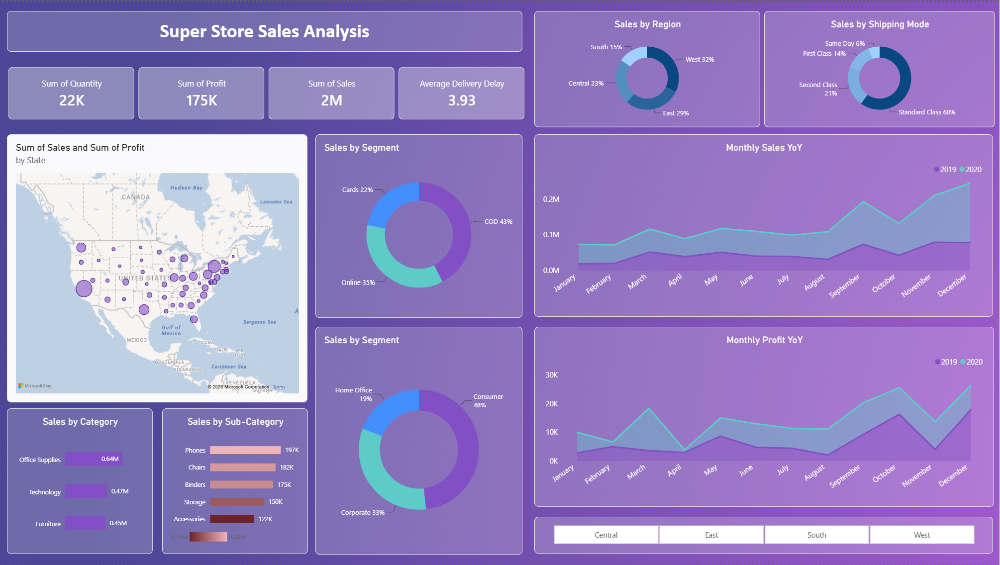
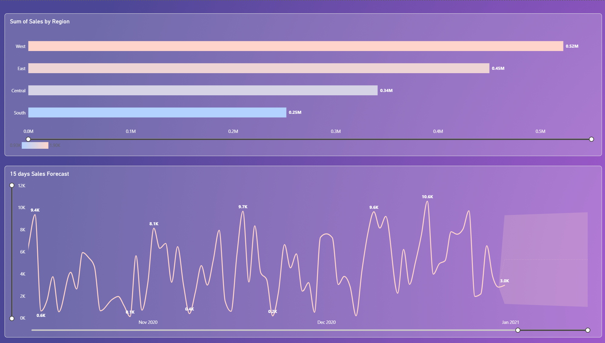

# 🛒 Superstore Sales & Profitability Analysis

> End-to-end Superstore sales analysis: Python EDA on 5,900+ transactions plus an interactive Power BI dashboard with YoY trends and 15-day sales forecasting.

<p align="center">
  
</p>

---

## 📌 Project Overview

This project analyses **5,901 retail transactions (2019–2020) across 21 attributes** to understand what drives sales and profit, where the business is strongest and weakest, and how fulfilment performs. The work has two parts:

1. **Exploratory Data Analysis (EDA)** in Python using Pandas and Plotly
2. **Interactive Power BI dashboard** with KPI cards, a geographic map, YoY trends and a 15-day sales forecast

## 🎯 Business Questions

- How do sales and profit vary by month, category, sub-category and customer segment?
- Which regions and states perform best, and where is the opportunity for growth?
- How do shipping mode, payment mode and delivery delay look across orders?
- What does the short-term sales outlook look like?

## 🗂️ Dataset

| Detail | Value |
|---|---|
| Records | 5,901 transactions |
| Columns | 21 (Order, Customer, Location, Product, Sales, Quantity, Profit, Returns, Payment Mode, etc.) |
| Period | 2019 – 2020 |
| Geography | United States (Central, East, South, West regions) |

## 🧹 Data Preparation (Python)

- Fixed encoding artefacts in column names and renamed the malformed `Row ID` column
- Dropped completely empty columns
- Converted `Order Date` and `Ship Date` to datetime
- Engineered `Order Month`, `Order Year` and `Order Day of Week` for time-based analysis

## 🔍 Analysis Performed

- Descriptive statistics of sales, quantity and profit
- Monthly sales and profit trends
- Sales and profit by **category** and **sub-category**
- Sales and profit by **customer segment**, including sales-to-profit ratio

## 📊 Power BI Dashboard

<p align="center">
  
</p>

**Dashboard features**
- KPI cards: Total Quantity, Profit, Sales and Average Delivery Delay
- State-level map of sales and profit
- Sales by region, shipping mode, customer segment, payment mode, category and sub-category
- **YoY monthly sales and profit** comparison (2019 vs 2020)
- Interactive **region slicers**
- **15-day sales forecast** using Power BI's built-in time-series forecasting with confidence intervals

## 💡 Key Findings

- 💰 About **$1.57M in sales** and **$175K in profit**, an overall margin of about **11.2%**
- 🌎 **West (32%) and East (29%)** generate about 61% of sales, while the **South (15%)** lags behind
- 🗃️ **Office Supplies** is the top category (about $0.64M); **Phones ($197K)** and **Chairs ($182K)** lead the sub-categories
- 👥 **Consumers** account for **48%** of sales, followed by Corporate (33%) and Home Office (19%)
- 💳 **Cash on Delivery** is the most-used payment mode (43%), ahead of Online (35%) and Cards (22%)
- 🚚 **Standard Class** carries 60% of orders, with an **average delivery delay of 3.93 days**
- 📈 Clear **Q4 seasonality**, with sales and profit peaking in September and November–December

## 🧠 Business Recommendations

- Invest in marketing and distribution in the **South** to close the gap with other regions
- Review shipping options to cut the average delivery delay of 3.93 days
- Prepare inventory ahead of **Q4**, when demand peaks
- Encourage online payments to reduce reliance on Cash on Delivery

## ⚠️ Forecast Note

The 15-day forecast comes from Power BI's built-in forecasting. Daily sales are highly volatile, so the confidence band is wide. The forecast is best used as a directional planning tool, not a precise prediction.

## 🛠️ Tools & Technologies


## 📁 Repository Structure

```
├── images/
│   ├── main_dashboard.png
│   └── sales_forecasting.png
├── LICENSE
├── README.md
├── SuperStore_Sales_Dataset.csv            # Dataset
├── Super_Store_Sales_Data_Analysis.ipynb   # EDA notebook
└── Super_Store_Sales_Data_Analysis.pbix    # Power BI dashboard file
```

## ▶️ How to Run

1. Clone the repository
   ```bash
   git clone https://github.com/jaythecool/super-store-sales-data-analysis.git
   cd super-store-sales-data-analysis
   ```
2. Install the dependencies
   ```bash
   pip install pandas plotly jupyter
   ```
3. Open the notebook
   ```bash
   jupyter notebook Super_Store_Sales_Data_Analysis.ipynb
   ```
4. Open `Super_Store_Sales_Data_Analysis.pbix` in **Power BI Desktop** to explore the dashboard.

## 👤 Author

**[Your Name]**
[LinkedIn](https://www.linkedin.com/in/jayesh-vengurlekar-80309214b/) · [GitHub](https://github.com/jaythecool) ·
---
